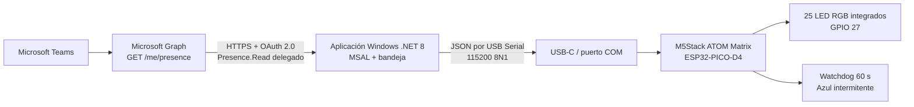

# Diagrama técnico

## Flujo
1. La app adquiere un token delegado con MSAL.
2. Consulta `GET https://graph.microsoft.com/v1.0/me/presence`.
3. Convierte `availability` y `activity` a color y efecto.
4. Detecta el ATOM por handshake serial.
5. Envía una línea JSON y el firmware actualiza la matriz.
