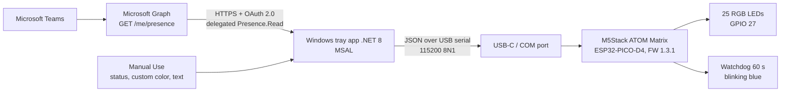

# Technical diagram

## Flow

1. **Automatic:** the app gets a delegated token with MSAL and polls `GET /me/presence`.
2. **Manual:** the user picks a status, a custom color or a text message from the tray menu.
3. The app converts the choice into a JSON command and sends it over USB.
4. In manual mode, the app sends `ping` every 20 s to keep the watchdog from firing.
5. The firmware draws the pattern and runs the effect or text animation on its own timer.