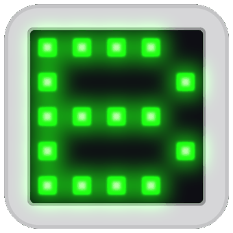

# BusyLightStatus

Busy light for Microsoft Teams built on an **M5Stack ATOM Matrix** (ESP32, 5×5 RGB LEDs) and a **Windows tray app in .NET 8**. It helps people in meetings avoid interruptions.

<p align="center">
  
</p>

## Features

- **Automatic (Teams):** reads your own presence through Microsoft Graph and shows it on the ATOM.
- **Manual Use:** six statuses (Available, Busy, In a meeting, Do not disturb, Presenting, Away). Enabled automatically when Entra ID is not configured or not authorized.
- **Custom color:** any RGB color with brightness from 10 to 100.
- **Text message:** up to 15 characters, shown letter by letter (500 ms each), with a fixed color or random colors.
- **Watchdog:** if the app stops sending data for 60 s, the ATOM blinks blue.
- **Device setup and firmware installation:** detects a compatible M5Stack ATOM Matrix, validates the ESP32 chip and flash memory, and installs the packaged firmware directly from BusyLightStatus. No VS Code, PlatformIO, Python or Git required on the target PC.

## Hardware

| Item | Details |
|---|---|
| Board | M5Stack ATOM Matrix (ESP32-PICO-D4, 25 WS2812C LEDs on GPIO 27) |
| Cable | USB-C with data support |
| Extra wiring | None |

M5Stack product page: https://docs.m5stack.com/en/core/Atom-Matrix

See [CONNECTIONS.md](CONNECTIONS.md) and [DIAGRAM.md](DIAGRAM.md).

## Repository structure

```text
firmware/atom-matrix/   PlatformIO firmware (FW 1.5.0)
src/BusyLight.Tray/     .NET 8 tray app
tests/                  PowerShell serial tests
scripts/                Firmware packaging scripts
dist/firmware/          Production firmware package and manifest
```

## 1. Flash the firmware for development

Developers can continue to use PlatformIO:

```powershell
cd firmware\atom-matrix
pio run
pio run --target upload
```

Set `upload_port` and `monitor_port` in `platformio.ini` to your COM port.

**End users do not need PlatformIO.** BusyLightStatus 1.5.0 can validate and install the packaged firmware from the Windows tray application. See [Device setup and firmware installation](#5-device-setup-and-firmware-installation).

## 2. Configure the app

Copy `src/BusyLight.Tray/appsettings.example.json` to `appsettings.json` in the same folder.

| Setting | Description |
|---|---|
| `TenantId` | Directory (tenant) ID |
| `ClientId` | Application (client) ID. Leave the placeholder to run in Manual Use only |
| `PollSeconds` | Presence polling interval (10-30 s) |
| `SerialBaudRate` | 115200 |
| `Brightness` | Brightness in automatic mode (10-100) |

`appsettings.json` is excluded by `.gitignore`. Never commit it.

### Entra ID app registration

Automatic Teams presence requires a Microsoft Entra ID application registered as a **public desktop client**.

Configuration:

- **Supported account type:** Accounts in this organizational directory only
- **Platform:** Mobile and desktop applications
- **Redirect URI:** `http://localhost`
- **Allow public client flows:** Yes
- **Microsoft Graph permission:** Delegated `Presence.Read`
- **Client secret:** Not required

BusyLightStatus authenticates the signed-in user with MSAL and reads only that user's Teams presence through:

`GET https://graph.microsoft.com/v1.0/me/presence`

> Do not configure `http://localhost` as a Single-Page Application (SPA) redirect URI. BusyLightStatus is a native Windows desktop/public client application.

## 3. Build and run

Requirements: .NET 8 SDK.

```powershell
dotnet build .\BusyLightPilot.sln -c Release
dotnet run --project .\src\BusyLight.Tray\BusyLight.Tray.csproj
```

The app finds an ATOM running BusyLightStatus firmware automatically on an available COM port.

## 4. Installer

A per-user installer (no administrator rights needed) is built with Inno Setup from `BusyLightStatus.iss`.

See [BUILD.md](BUILD.md) for the full build, firmware packaging and deployment process.

## 5. Device setup and firmware installation

BusyLightStatus can prepare a new M5Stack ATOM Matrix without requiring VS Code, PlatformIO, Python or Git on the target PC.

From the Windows tray menu:

```text
Firmware
├── Check device compatibility...
└── Install firmware...
```

### Device compatibility check

Before firmware installation, BusyLightStatus:

1. Detects available serial ports.
2. Temporarily releases the application's serial connection.
3. Runs the packaged `esptool`.
4. Identifies the ESP32 chip.
5. Confirms a compatible ESP32-PICO-D4.
6. Verifies at least 4 MB of flash memory.
7. Reads the device MAC address.
8. Verifies the packaged firmware manifest.

No flash operation is performed during this check.

### Firmware installation

Before writing firmware, BusyLightStatus validates the device again and confirms that the MAC address matches the previously validated device.

The packaged `manifest.json` defines:

- Firmware version
- Compatible chip
- Minimum flash size
- Firmware file
- Flash offset
- Flash baud rate
- Firmware size
- SHA-256 checksum
- Supported USB identifiers

The current firmware package uses:

```text
Firmware: BusyLightStatus 1.5.0
Chip: ESP32 / ESP32-PICO-D4 compatible
Minimum flash: 4 MB
Offset: 0x0
Baud: 115200
```

BusyLightStatus verifies the firmware file size and SHA-256 checksum before writing the firmware.

After flashing, the ATOM is restarted and BusyLightStatus verifies the installation over USB serial. Installation is considered successful only when the device identifies itself as:

```text
device: BUSYLIGHT-ATOM
firmware: 1.5.0
```

After a successful verification, BusyLightStatus reconnects to the ATOM and restores the previously active status.

> Do not disconnect the ATOM, press Reset or close BusyLightStatus while firmware is being written.

## Serial protocol

One JSON object per line, 115200 baud, 8N1.

| Command | Example |
|---|---|
| `identify` | `{"cmd":"identify"}` |
| `ping` | `{"Cmd":"ping"}` |
| `setStatus` (full) | `{"Cmd":"setStatus","Color":"#FF0000","Effect":"pulse","Brightness":95}` |
| `setStatus` (corners off) | `{"Cmd":"setStatus","Pattern":"rounded","Color":"#00FF00","Effect":"solid","Brightness":95}` |
| `setStatus` (traffic light) | `{"Cmd":"setStatus","Pattern":"lights","Top":"#FF0000","Middle":"#FFC000","Bottom":"#00FF00","Effect":"solid","Brightness":80}` |
| `setText` | `{"Cmd":"setText","Text":"IN A MEETING","Color":"#00A0FF","Random":false,"Brightness":80}` |

Effects: `solid`, `pulse`, `doublepulse`, `blink`.

## Status colors

| Status | Color | Effect |
|---|---|---|
| Available | Green | Solid |
| Busy | Red | Solid |
| In a meeting / In a call | Red | Pulse |
| Do not disturb | Red | Double pulse |
| Presenting | Magenta | Pulse |
| Away / Be right back | Yellow | Solid |
| No data for 60 s | Blue | Blink |

## Tests

Close the app first so the COM port is free.

```powershell
powershell -ExecutionPolicy Bypass -File .\tests\test_regression.ps1
```

| Script | Checks |
|---|---|
| `test_regression.ps1` | Identify and the six full-matrix statuses |
| `test_lights_ping.ps1` | Traffic-light pattern and watchdog renewal |
| `test_text.ps1` | Text, Ñ, accents, 15-character limit |
| `test_rounded.ps1` | Manual statuses with corners off |

## 🥚 Something is hiding

> Not every message is meant to be read.
> One of them wakes something up: it moves without a sound, grows with every apple it finds,
> and won't rest until the whole light is full.
> If you can name it, the light will play along.
>
> No computer around? They say the light answers to those who are patient with it.

## Privacy and security

- Reads only the signed-in user's own presence with delegated Microsoft Graph permission `Presence.Read`.
- Uses the public-client OAuth flow. No client secret is required or embedded in the application.
- No credentials are stored on the ATOM.
- No presence history is recorded.
- Firmware is validated against the packaged manifest before installation.
- Firmware file size and SHA-256 are verified before flashing.
- The target chip, flash size and device MAC are checked before `write_flash` is allowed.

## License

MIT. See [LICENSE](LICENSE).

## Acknowledgments and inspiration

BusyLightStatus started as a personal project, inspired by two community projects that show Microsoft Teams presence on an LED device. They were the starting point for the idea and the approach:

- **Elio Struyf**, *DIY: Building a busy light to show your Microsoft Teams presence*  
  https://www.eliostruyf.com/diy-building-busy-light-show-microsoft-teams-presence/  
  A step-by-step guide to building a do-it-yourself busy light that shows your Microsoft Teams presence status.

- **Caroline Dunn**, *Status Light Indicator* (`unicorn-busy-server`)  
  https://github.com/carolinedunn/unicorn-busy-server  
  A simple busy light server for Raspberry Pi Zero and the Pimoroni Unicorn HAT.

BusyLightStatus was written from scratch for the M5Stack ATOM Matrix and a .NET tray application, and **no code from these projects is included**. Many thanks to Elio Struyf and Caroline Dunn for sharing their work with the community.
